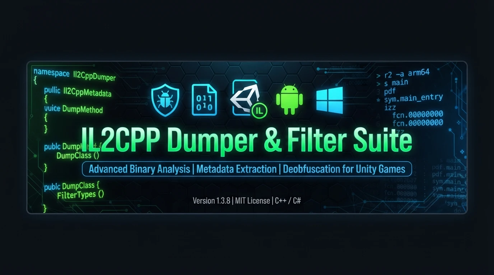
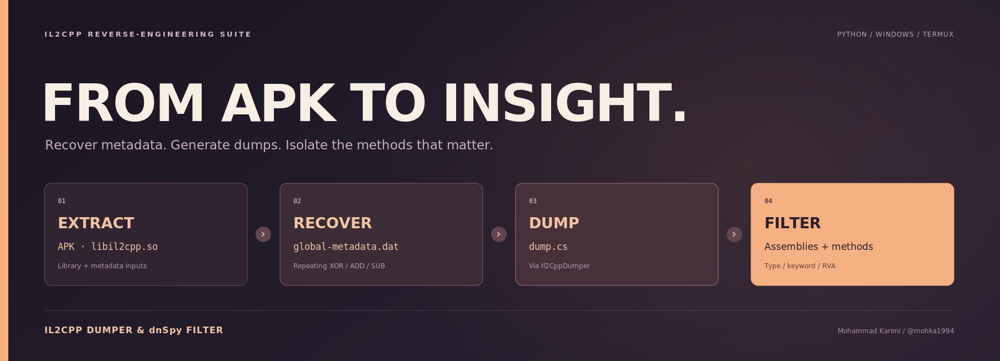
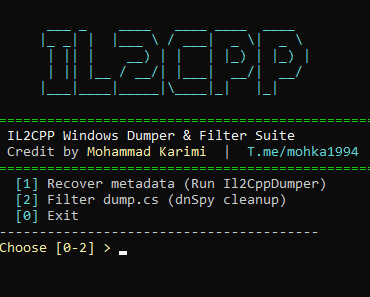

<div align="center">

# IL2CPP-Dumper-Filter-Suite



[](#requirements)
[](#supported-platforms)
[](LICENSE)
[](#)

**Recover supported Unity IL2CPP metadata, manage dumper workflows, and turn oversized `dump.cs` files into focused, dnSpy-style reports for static analysis.**

**Developer:** Mohammad Karimi · [@mohka1994](https://t.me/mohka1994) · [GitHub: mohamadkarimi2026](https://github.com/mohamadkarimi2026)

[`docs/guide_fa_en.html`](docs/guide_fa_en.html) · [Features](#features) · [Quick Start](#quick-start) · [CLI Reference](#command-line-reference)

</div>



> **Responsible use:** Use this toolkit only with software and data you own or are explicitly authorized to inspect. Read the [Disclaimer](#disclaimer) before use.

## Overview

IL2CPP-Dumper-Filter-Suite provides separate Windows and Android / Termux entry points for supported metadata recovery, dumper orchestration, and `dump.cs` filtering. It accepts an APK or extracted Android `libil2cpp.so` and metadata input, and can also filter an existing dump without running the recovery workflow. The wrapper scripts use the Python standard library and do not create an executable DLL or reconstruct method bodies.



## Contents

- [Features](#features)
- [Supported Platforms](#supported-platforms)
- [Requirements](#requirements)
- [Quick Start](#quick-start)
- [Windows](#windows)
- [Android / Termux](#android--termux)
- [Filtering an Existing Dump](#filtering-an-existing-dump)
- [Command-Line Reference](#command-line-reference)
- [Filtering Behavior and Limitations](#filtering-behavior-and-limitations)
- [Output Example](#output-example)
- [Documentation](#documentation)
- [Troubleshooting](#troubleshooting)
- [License](#license)
- [Disclaimer](#disclaimer)

## Features

- **Automated Metadata & Dump Management** — Works with an APK or extracted `libil2cpp.so` and metadata input; recovers supported plaintext or common repeating-key `sub`, `add`, and `xor` transformed metadata when a key is discoverable and the result validates. Can hand recovered inputs to a separately installed dumper.
- **dnSpy-Style Structural Organization** — Groups output by source assembly, preserves class and namespace structure, labels empty namespaces as `GlobalNamespace`, and retains RVA-oriented method annotations for quick navigation.
- **Aggressive & Smart Type Filtering** — Focuses on selected scalar and game-relevant return types (`bool`, `int`, `SafeInt`, `void`, `float`, `double`, `Single`, `Double`, `SafeFloat`) while excluding noisy generic or complex signatures.
- **Sub-string & Keyword Heuristics** — Case-insensitive substring matching surfaces method names that contain useful terms such as `has_`, `vip`, `purchase`, `coin`, `gold`, `gem`, `energy`, `unlock`, `price`, and `reward`. Add project-specific terms with `-k`.
- **Noise & Tracker Blacklisting** — Filters common utility/compiler noise and SDK, analytics, advertising, tracker, demo, test, and debug-related classes. Examples of SDK families that may be excluded include AdMob, IronSource, UnityAds, Adjust, AppsFlyer, Crashlytics, and Tenjin; exact matches depend on the filter patterns and input dump.
- **Dynamic Assembly Manager** — Interactive filter menu for managing target assemblies, including selecting, adding/removing, resetting, or auto-detecting targets where supported by the menu.
- **Dual Interface (Interactive & CLI)** — Use the guided interactive workflow for hands-on analysis, or CLI flags for repeatable scripts and automation.
- **Two platform-specific entry points** — `il2cpp_windows.py` for Windows and `il2cpp_android.py` for Android / Termux.

## Supported Platforms

| Entry point | Host / environment | Python | Dumper integration |
| --- | --- | --- | --- |
| `il2cpp_windows.py` | Windows | 3.8+ | Existing `Il2CppDumper.exe` (provided separately) |
| `il2cpp_android.py` | Android / Termux; standard Linux environments | 3.10+ | `Il2CppDumper-Python` repository or an existing Python dumper script |

The Windows program runs on Windows but its recovery library input is an **Android ELF `libil2cpp.so`**. It does not use a native Windows `GameAssembly.dll` as the recovery input. The wrapper scripts require no third-party Python packages. Dumper dependencies are external and must be installed according to the dumper's own instructions.

## Requirements

- Python **3.8 or newer** for Windows; **3.10 or newer** for Android / Termux.
- An APK, or a matching Android `libil2cpp.so` and metadata file (often named `global-metadata.dat` or `sysinfo.dat`).
- A compatible dumper only when you want to generate a dump: Windows `Il2CppDumper.exe`, or the Android [Il2CppDumper-Python](https://github.com/springmusk026/Il2CppDumper-Python) repository/script.

## Quick Start

Clone or download the project, then run the relevant platform script from its directory:

```bash
git clone https://github.com/mohamadkarimi2026/IL2CPP-Dumper-Filter-Suite.git
cd IL2CPP-Dumper-Filter-Suite
```

Start an interactive workflow:

```bash
python il2cpp_windows.py   # Windows
python il2cpp_android.py   # Android / Termux
```

To see supported options for either entry point:

```bash
python il2cpp_windows.py --help
python il2cpp_android.py --help
```

## Windows

Run the interactive menu:

```powershell
python --version
python il2cpp_windows.py
```

Use an APK or extracted files. Update paths for your environment:

```powershell
# APK input
python il2cpp_windows.py --apk "C:\game\game.apk" --out "C:\il2cpp_result" --dumper-exe "C:\Tools\Il2CppDumper.exe"

# Extracted Android ELF library and matching metadata
python il2cpp_windows.py --lib "C:\game\libil2cpp.so" --metadata "C:\game\sysinfo.dat" --out "C:\il2cpp_result" --dumper-exe "C:\Tools\Il2CppDumper.exe"

# Recover metadata only; do not launch the dumper
python il2cpp_windows.py --lib "C:\game\libil2cpp.so" --metadata "C:\game\sysinfo.dat" --out "C:\il2cpp_result" --no-dump
```

The Windows script does **not** download the dumper. Obtain `Il2CppDumper.exe` separately and provide `--dumper-exe`, or place it in a location the script can auto-detect. In APK mode, the script prompts you to select library and metadata candidates; for unattended workflows, extract them first and pass `--lib` and `--metadata`.

## Android / Termux

Install Python and Git, grant storage access if needed, then start the script:

```bash
pkg update
pkg install python git -y
termux-setup-storage
python --version
python il2cpp_android.py
```

The interactive script can use an APK beside the script or an explicitly supplied path. For CLI usage with an existing dumper repository:

```bash
python il2cpp_android.py \
  --apk /sdcard/Download/game.apk \
  --out ~/il2cpp_result \
  --dumper-dir ~/Il2CppDumper-Python \
  --no-clone
```

To allow non-interactive download of a missing dumper repository, use `--yes`:

```bash
python il2cpp_android.py --apk /sdcard/Download/game.apk --out ~/il2cpp_result --yes
```

Use extracted inputs and skip dumper execution:

```bash
python il2cpp_android.py \
  --lib /sdcard/Download/libil2cpp.so \
  --metadata /sdcard/Download/sysinfo.dat \
  --out ~/il2cpp_result \
  --no-dump
```

Android uses [Il2CppDumper-Python](https://github.com/springmusk026/Il2CppDumper-Python). If its repository is not available, interactive mode asks before downloading; non-interactive download requires `--yes`. Use `--no-clone` to prevent downloading. The expected package entry point is `il2cpp_dumper_py/__main__.py`. Alternatively, `--dumper-script` points to an existing Python script; it is run with the library, metadata, and output directory arguments. It does not accept a DLL or `.exe` as the Python script.

## Filtering an Existing Dump

Run a filter directly on an existing `dump.cs`, or open the interactive assembly/filter manager:

```bash
# Interactive filter manager
python il2cpp_windows.py -fm -fi dump.cs
python il2cpp_android.py -fm -fi dump.cs

# CLI filtering with custom assemblies and additional keywords
python il2cpp_windows.py -f -fi dump.cs -fo filtered.txt \
  -a Assembly-CSharp.dll LogicAssembly.dll \
  -k vip unlock purchase
```

The default output path is `filtered_dnspy_dump.txt`. Use separate input and output paths. To run standalone Android `-f` filtering non-interactively, provide non-TTY standard input, for example:

```bash
python il2cpp_android.py -f -fi dump.cs -fo filtered.txt \
  -a Assembly-CSharp.dll -k vip unlock < /dev/null
```

Use `-fm` for the interactive Android filter menu. Android's standalone filter mode expects non-TTY standard input; its interactive menu handles selection in the terminal.

## Command-Line Reference

Options common to both platform scripts (some require platform-specific context):

```text
--apk APK                 APK containing the library and metadata
--lib LIB                 Extracted Android libil2cpp.so
--metadata META           Metadata / sysinfo.dat input (required with --lib)
--out OUT                 Output directory (default: ./il2cpp_result)
--no-dump                 Recover metadata only; do not run a dumper
-f,  --filter             Run automatic filtering
-fm, --filter-menu        Open the interactive assembly/filter manager
-fi, --filter-input FILE  Input dump.cs for filtering
-fo, --filter-out FILE    Filtered output (default: filtered_dnspy_dump.txt)
-k,  --keywords WORD ...  Additional keywords (space-separated)
-a,  --assemblies DLL ... Target assembly names (space-separated; replaces defaults)
-h,  --help               Show help
```

Windows-specific:

```text
--dumper-exe EXE          Path to an existing Il2CppDumper.exe
```

Android-specific:

```text
--dumper-dir REPOSITORY   Path to an existing Il2CppDumper-Python repository
--dumper-script FILE      Path to an existing Python dumper script
--no-clone                Do not download the dumper repository
--yes                     Permit repository download in non-interactive mode
```

Choose either `--apk` or the pair `--lib` and `--metadata`; do not combine APK and extracted-file input. `-fi` or `-fo` alone does not activate filtering—use `-f` or `-fm`. Run each script with `--help` for the authoritative options available in that installed version.

## Filtering Behavior and Limitations

- The default assembly targets are `ScriptsAssembly.dll`, `LogicAssembly.dll`, `Assembly-CSharp.dll`, `UtilsScripts.dll`, and `Assembly-CSharp-firstpass.dll`. Supplying `-a` replaces this list.
- `-k` adds terms to built-in keyword heuristics; matching is case-insensitive substring matching on method names, not regular-expression matching.
- Filtering relies on the input dump's image/assembly headers, type indices, RVA annotations, and methods with bodies. It selects existing text; it does not reconstruct method bodies or create a DLL.
- The selected return types are `bool`, `int`, `SafeInt`, `void`, `float`, `double`, `Single`, `Double`, and `SafeFloat`. Generic/string signatures and common methods such as `ToString`, `GetHashCode`, and `Equals` are generally excluded.
- Noise filtering is heuristic. It targets common telemetry, ad/analytics SDK, tracker, demo, test, and debug patterns, but cannot guarantee every unwanted symbol is removed or every useful symbol retained.
- Assembly matching is case-insensitive on Windows and case-sensitive on Android. Windows creates the output parent directory; on Android, the output directory must already exist.
- `--no-dump` stops after recovery and does not run post-dump filtering, even when `-f` is also specified. Check the reported status and output files; a successful metadata recovery is not by itself proof that a dump was generated.
- Metadata recovery handles plaintext and some common repeating-key `sub` / `add` / `xor` schemes when a candidate key can be found and validated. Custom transforms, unsupported layouts, malformed inputs, or undiscoverable keys can fail.

## Output Example

Illustrative filtered output, organized by assembly and class with method address annotations for cross-referencing in dnSpy, Radare2, or Ghidra. The exact fields depend on what the source dump contains:

```csharp
// ========================================
// === Assembly-CSharp.dll ===
// ========================================

namespace GlobalNamespace
{
    public class PlayerEconomyController
    {
        public bool hasEnoughGems(int cost) { }
        // RVA: 0x01A34B20 Offset: 0x01A34B20 VA: 0x01A34B20

        public void AddCoins(int amount) { }
        // RVA: 0x01A34C40 Offset: 0x01A34C40 VA: 0x01A34C40

        public bool isVipActive() { }
        // RVA: 0x01A34D80 Offset: 0x01A34D80 VA: 0x01A34D80
    }
}
```

Address annotations are copied from the dump and are useful as cross-reference comments. VA interpretation can depend on the binary's load base and analysis setup; confirm address mappings in your chosen tool.

## Documentation

See the [`docs/guide_fa_en.html`](docs/guide_fa_en.html) for additional documentation. For tool-specific behavior and current options, also consult each script's `--help` output and the external dumper's documentation.

## Troubleshooting

- **Metadata recovery fails:** Verify that the library is an Android ELF `libil2cpp.so`, that the metadata belongs to the same application build, and that the input layout is supported. Custom protection schemes may need another recovery method.
- **Windows cannot find a dumper:** Supply a valid `Il2CppDumper.exe` with `--dumper-exe`. The Windows wrapper does not download it.
- **Android dumper is missing or incomplete:** Check the repository path and its `il2cpp_dumper_py/__main__.py` entry point, or use `--yes` to permit a missing repository to be downloaded in non-interactive mode.
- **Filtered output is empty or unexpectedly small:** Check that the dump has the expected assembly/type/RVA structure, confirm assembly names, and broaden or customize keywords. The filter intentionally excludes many signatures and noise patterns.
- **Android standalone filter behaves interactively:** Use non-TTY standard input for standalone `-f`, or choose `-fm` for interactive filtering.

## License

Distributed under the [MIT License](LICENSE). See the repository's `LICENSE` for the full license text.

## Disclaimer

This project is provided for educational, authorized security auditing, and reverse-engineering research. You are solely responsible for ensuring that your use complies with applicable laws, licenses, terms of service, and the rights of software owners. Do not use the toolkit to access, modify, or analyze software or data without permission. The project is provided **“as is,” without warranty of any kind**, as stated in the MIT License. The authors and contributors assume no liability for misuse, damages, or legal consequences arising from its use.
